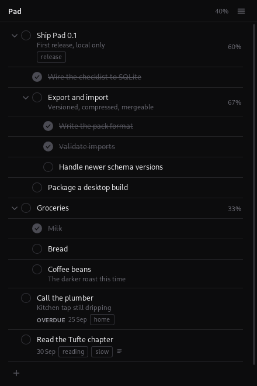

# Pad

A small checklist on your desk.

Pad opens straight onto your tasks. No dashboard, no onboarding, no sidebar, no
calendar. Tasks nest as deeply as you like, carry a due date, tags and notes,
and live in a SQLite file on your own machine. There is no account, no server
and no telemetry.



## What it does

- **Opens to the checklist.** Existing tasks are on screen immediately.
- **Real hierarchy.** A task can contain subtasks, which can contain subtasks.
  Create, edit, complete, reopen, delete, reorder, indent and outdent, by mouse
  or keyboard. A task can never be moved inside itself.
- **Honest percentages.** Progress counts leaf tasks, so a deep branch is not
  counted once per level. Ticking a parent ticks everything under it; a parent
  closes when its last child closes and reopens the moment one reopens.
- **Due dates.** An unfinished task past its due date is marked **Overdue**.
- **Tags** as compact monochrome labels, shared by name across tasks.
- **Notes** as plain text. A pasted http(s) link becomes a compact embed —
  favicon, title or hostname, domain — and opens in your system browser.
- **Local export and import** through the menu, in a documented, versioned,
  compressed format. See [docs/data-format.md](docs/data-format.md).

## Keyboard

The checklist is a single tab stop; arrows move within it.

| Key | Action |
| --- | --- |
| `N` | Start a new task |
| `Enter` | Add the typed task, ready for the next |
| `Tab` / `Shift+Tab` | Nest the task deeper or shallower |
| `↑` / `↓` | Move between tasks |
| `Alt+↑` / `Alt+↓` | Reorder within the list |
| `Alt+←` / `Alt+→` | Outdent or indent |
| `Space` | Complete or reopen |
| `Enter` on a task | Open it |
| `F2` | Rename in place |
| `←` / `→` | Collapse or expand |
| `Delete` | Delete the task |
| `Escape` | Back, or close what is open |

The same list is in the app under **Menu → Keyboard shortcuts**.

## Building

Pad is [Tauri](https://tauri.app) 2 with a Rust backend, a plain TypeScript
frontend (no framework) and SQLite via `rusqlite` with the bundled amalgamation.

### Prerequisites

- [Rust](https://rustup.rs) 1.77 or newer
- Node.js 18 or newer
- On Debian/Ubuntu:

  ```sh
  sudo apt-get install -y build-essential pkg-config \
    libwebkit2gtk-4.1-dev libgtk-3-dev librsvg2-dev \
    libayatana-appindicator3-dev libxdo-dev libssl-dev
  ```

  On macOS, Xcode command line tools. On Windows, the MSVC build tools and
  WebView2 (preinstalled on Windows 11).

### Run

```sh
npm install
npm run tauri dev
```

### Package

```sh
npm run tauri build
```

Bundles land in `src-tauri/target/release/bundle/` — `.deb` and `.AppImage` on
Linux, `.dmg` on macOS, `.msi`/`.exe` on Windows. For convenience the Linux
bundles are also copied to `release/` in this repo (not committed):

| Artifact | Size | Notes |
| --- | --- | --- |
| `Pad_0.1.0_amd64.deb` | ~3.3 MB | Uses the system WebKitGTK. `sudo apt install ./Pad_0.1.0_amd64.deb` |
| `Pad_0.1.0_amd64.AppImage` | ~105 MB | Self-contained; bundles GTK and WebKit. `chmod +x` and run. |

The bare binary is `src-tauri/target/release/pad` (about 7 MB).

### Tests

```sh
cd src-tauri && cargo test     # storage, hierarchy, ordering, export/import
npx tsc --noEmit               # frontend types
```

## Layout

```
src/                     frontend, plain TypeScript
  main.ts                window shell and routing
  store.ts               snapshot, tree index, leaf-based percentages
  api.ts                 typed wrappers over the Tauri commands
  icons.ts               the icon set, one geometry throughout
  views/
    checklist.ts         the task stack: rows, keyboard, reordering
    detail.ts            an opened task: fields, notes, child checklist
    links.ts             link detection and embeds
    menu.ts              the menu, export/import, shortcuts, about
src-tauri/
  migrations/            numbered SQL, applied by PRAGMA user_version
  src/db/                connection, schema, task and tag queries
  src/db/position.rs     fractional order keys
  src/links.rs           bounded metadata and favicon fetching
  src/transfer.rs        .padpack export and merging import
  src/tests.rs           behaviour tests
docs/data-format.md      storage, export format, and notes for a future sync
```

Storage logic lives entirely in `src-tauri/src/db` and `transfer.rs`; the
frontend only ever sees the typed commands in `src/api.ts`.

## Accounts

There are none, and Pad never requires one. The menu has an **Account** entry
marked *Coming later*; it does nothing. Nothing is uploaded, and no sign-in is
simulated.

## Network

Pad talks to the network in exactly one case: fetching the title and favicon
for an http(s) link you put in a note. Those requests are capped in time (6s),
size (256 kB of HTML, 48 kB of icon) and redirects (3), refuse non-http(s)
schemes, and refuse loopback and private addresses. Page metadata is treated as
untrusted text and is never inserted as markup. Results are cached locally, and
the cache is capped.

## Renaming

"Pad" is a working name. To change it, edit `productName`, `identifier` and the
window `title` in `src-tauri/tauri.conf.json`, the `name` in `package.json` and
`src-tauri/Cargo.toml`, and the wordmark string in `src/main.ts`. Changing
`identifier` moves the data directory, so export first if you have tasks worth
keeping.
